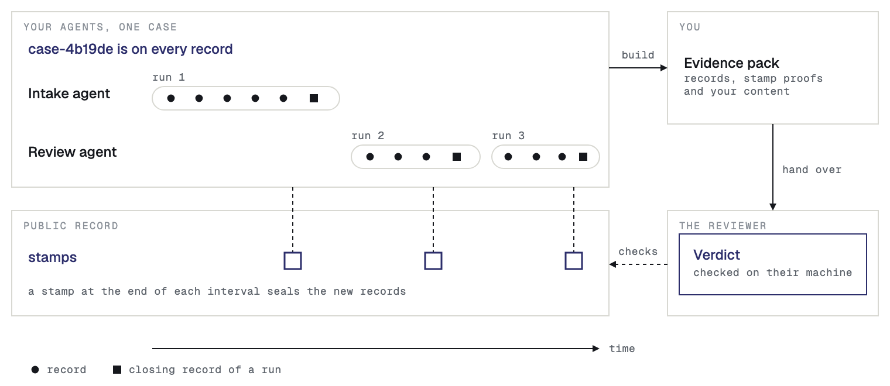
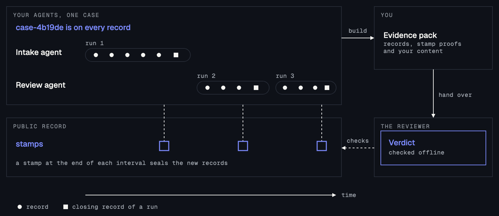

This page shows how to build the evidence pack for one case and hand it to a reviewer. Your agents already recorded the case through an [adapter](/adapters), with its case ID on every record.

<Note>
  To test, use a Sandbox API key, and see [Test in the Sandbox](/sandbox).
</Note>

## What an evidence pack holds

An evidence pack (defined in the [Introduction](/#core-ideas)) joins two halves. Sanning holds the signed records and the proofs that stamps cover them. You hold the content that the records hold hashes of, in your log store. Sanning never receives that content, so only you can put the halves together.

The pack is one zip file:

- `bundle.json`: the signed records, and for each record the proof that a stamp on the public record covers it.
- `logs/`: your content, one file for each record.

A reviewer needs the pack and the public record. They do not need Sanning, an account or access to your systems.




The diagram shows one case, from the first record to the verdict.

## Wait for the stamp

A pack needs the stamp proofs. Sanning seals the records of each 10-minute interval, and the proofs are ready about a minute later. The public record can take longer to confirm a stamp, sometimes hours. Until it does, the pack reads Incomplete, and the verifier says that the stamp names no public record. Build the pack again later.

The **Records** page in the console lists each record that Sanning received, with its agent, kind and signer. A **Witness** strip at the top of the list shows the block time of the latest stamp, which is the time the public record confirmed it. The page does not mark a single record as stamped, so the test is `bundle`, the command that builds the pack.

When records are not stamped yet, `bundle` writes nothing, says how many records are recorded and waiting for a stamp, and exits with code 2. Your records are not missing. Wait for the next stamp, and run the command again. When the stamp exists but the public record has not confirmed it, `bundle` writes the pack, the pack reads Incomplete, and the command exits with code 2 as well.

## Build the pack

Install the SDK where you run `bundle`. Reading an S3 log store needs the S3 library in TypeScript and the `s3` extra in Python, the same as the [Quickstart](/quickstart#install-the-sdk):

<CodeGroup>

```bash TypeScript
npm install @sanning/anchor @aws-sdk/client-s3
```

```bash Python
pip install "sanning-anchor[s3]"
```

</CodeGroup>

Run `bundle` somewhere that can reach your log store, with your signing seed in the environment. The command reads your records from Sanning with your API key, reads the content from your log store, and checks the result the way a reviewer will before it writes anything. If the pack would fail the check, the command writes nothing.

<CodeGroup>

```bash TypeScript
export SANNING_API_KEY=API_KEY
export SANNING_SIGNING_SEED=SEED
export SANNING_S3_ENDPOINT=ENDPOINT
export SANNING_S3_ACCESS_KEY_ID=ACCESS_KEY_ID
export SANNING_S3_SECRET_ACCESS_KEY=SECRET_ACCESS_KEY

npx @sanning/anchor bundle \
  --agent claims-triage \
  --case case-4b19de \
  --logs s3://evidence-claims \
  --out case-4b19de.zip
```

```bash Python
export SANNING_API_KEY=API_KEY
export SANNING_SIGNING_SEED=SEED
export SANNING_S3_ENDPOINT=ENDPOINT
export SANNING_S3_ACCESS_KEY_ID=ACCESS_KEY_ID
export SANNING_S3_SECRET_ACCESS_KEY=SECRET_ACCESS_KEY

sanning-anchor bundle \
  --agent claims-triage \
  --case case-4b19de \
  --logs s3://evidence-claims \
  --out case-4b19de.zip
```

</CodeGroup>

{/* OUTPUT FROM REAL RUN: what bundle prints after it writes the pack for a case (the agent, the case, the record count, the path of the zip) */}

Replace the following:

- `API_KEY` with the Live API key from the [Quickstart](/quickstart#make-a-live-api-key). It already has the scope `anchor:read` that `bundle` needs.
- `SEED` with the seed of the agent in `--agent`. With the seed, `bundle` signs a declaration, which is the pack's own statement of which records it holds, so that the reviewer can check the pack against it. Without the seed, the pack carries no declaration.
- `ENDPOINT` with the address of your S3 service, such as `https://s3.us-east-1.amazonaws.com`. Add `SANNING_S3_REGION` if the bucket is not in `us-east-1`.
- `ACCESS_KEY_ID` and `SECRET_ACCESS_KEY` with credentials that hold the `bundle` permissions in the next paragraph.
- `claims-triage` with the agent ID of your agent.
- `case-4b19de` with your case ID.
- `s3://evidence-claims` with the S3 URL of your log store: `s3://BUCKET`, or `s3://BUCKET/PREFIX` for a prefix inside it.

The `bundle` credentials need `s3:GetObject` and `s3:PutObject` on `arn:aws:s3:::BUCKET/*`, and `s3:ListBucket` on `arn:aws:s3:::BUCKET`. Replace `BUCKET` with the name of your bucket.

A case pack takes no dates. It holds every record of the case that this agent recorded, however long the case ran. The command keeps a record only when its own signed case ID is the one you name, so a record that carries no case ID is not found. This is why every run must record with a case ID.

**What `bundle` sends to Sanning.** When the pack carries a declaration and reads Verified, `bundle` records the declaration as a record of its own, so that a later pack for the same case is visibly later. Each time it writes a pack, `bundle` also sends Sanning a pack report: the agent, the environment, the period, the record count and a hash of `bundle.json`. The pack report never holds the pack, a log or a file name. You find it under **Evidence** in the console.

The command exits with the code that the verifier would give the pack. The codes are in [Command line](/reference/cli#exit-codes).

### When several agents worked on the case

Give `--agent` once for each agent, and put each agent's seed in `SANNING_SIGNING_SEEDS`. The command then builds one pack for each agent, and writes them together as a case file, a zip that holds one pack for each agent.

<CodeGroup>

```bash TypeScript
export INTAKE_SEED=INTAKE_SEED_VALUE
export REVIEW_SEED=REVIEW_SEED_VALUE
export SANNING_SIGNING_SEEDS="intake=$INTAKE_SEED,review=$REVIEW_SEED"

npx @sanning/anchor bundle \
  --case case-4b19de \
  --agent intake \
  --agent review \
  --logs s3://evidence-claims \
  --out case-4b19de.zip
```

```bash Python
export INTAKE_SEED=INTAKE_SEED_VALUE
export REVIEW_SEED=REVIEW_SEED_VALUE
export SANNING_SIGNING_SEEDS="intake=$INTAKE_SEED,review=$REVIEW_SEED"

sanning-anchor bundle \
  --case case-4b19de \
  --agent intake \
  --agent review \
  --logs s3://evidence-claims \
  --out case-4b19de.zip
```

</CodeGroup>

Replace `INTAKE_SEED_VALUE` and `REVIEW_SEED_VALUE` with the seeds of the `intake` and `review` agents. Each is that agent's own signing seed, the one its anchorer signs with.

Each pack is signed by its own agent's signing key, and nobody signs the case file as a whole. The zip holds each pack under `packs/<agent>/`, an unsigned index named `contents.json`, and a `HOW-TO-VERIFY.txt`. Every agent that you name must have a pack, or the command writes nothing. If one agent's records are not stamped yet, the command exits with code 2, and you run it again later.

## Keep your content

The log store holds the content that your records hold hashes of. Sanning holds hashes only, so if the store is lost, the pack cannot carry the content, and no one can rebuild it. A reviewer can still check the signatures and the stamps without the content, but not what the records said.

Set up the log store before your agents record, because the adapter writes each step's content to the store as it records. The steps and the permissions are in [Set up your log store](/quickstart#set-up-your-log-store).

## Hand it over

The pack holds the content of every record that it finds in your log store. Check what you are giving away before you send it: the reviewer can read all of it.

Send the zip file. The reviewer follows [Verify an evidence pack](/evidence/verify), and needs no account.
