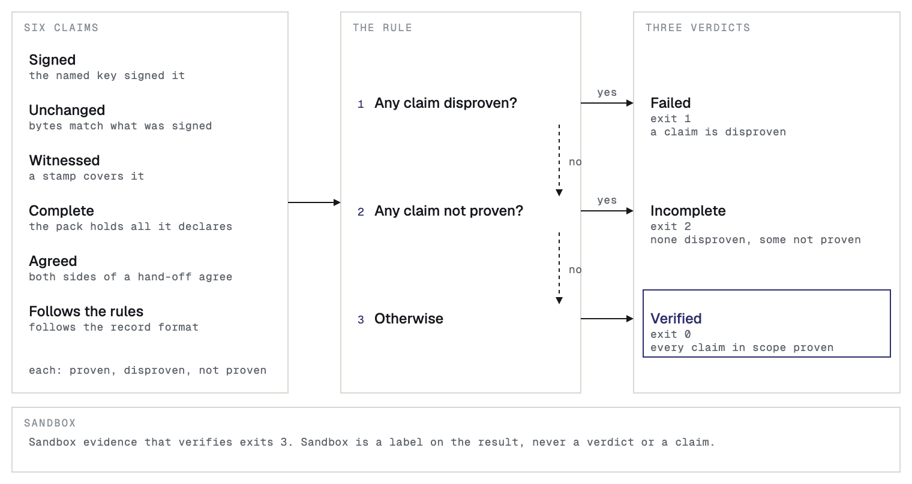
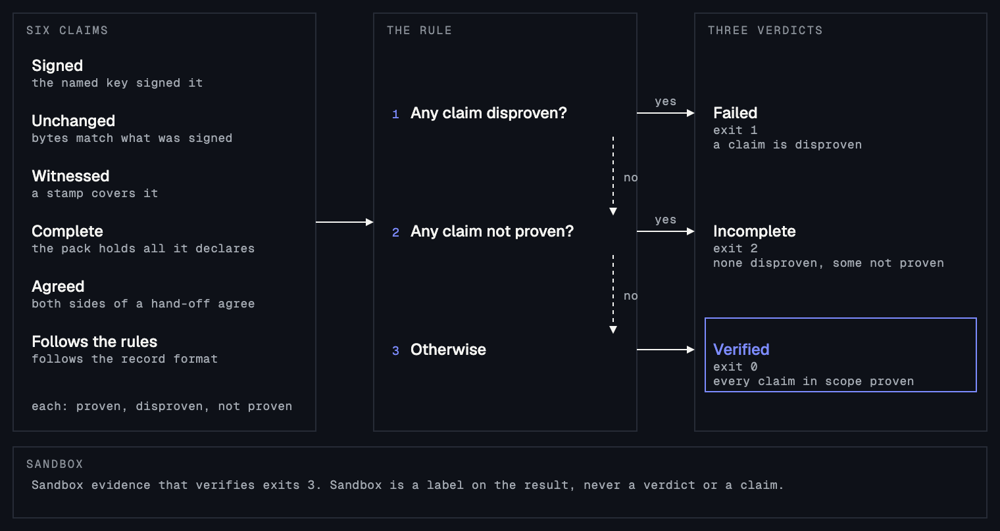

You need the evidence pack, a zip file, and it stays on your machine. To also look each stamp up on the public record, you need the address of a public gateway, a web server that serves the public record. Terms such as record, stamp and verdict are defined in the [Introduction](/#core-ideas).

## Check it in your browser

Open [verify.sanning.io](https://verify.sanning.io) and drop the zip file on the page. The check runs in your browser and the pack is never uploaded: the only data that leaves your browser is the public record ID of each stamp. The page looks the stamps up through a Sanning server, and it has no setting to change that. For a check with no Sanning server in it, use the command line with `--gateways` and a public gateway.

## Check it at the command line

Unzip the pack, and run the verifier on `bundle.json`. `--logs` points at the folder that holds the content.

<CodeGroup>

```bash Node.js
unzip case-4b19de.zip -d pack
npx @sanning/proof verify pack/bundle.json --logs pack/logs/
```

```bash Python
unzip case-4b19de.zip -d pack
pip install sanning-proof
sanning-proof verify pack/bundle.json --logs pack/logs/
```

</CodeGroup>

{/* OUTPUT FROM REAL RUN: the report that verify prints for a Verified pack, with its Witness line */}

Both commands read the pack offline and give the same answer, with the same exit codes. To look each stamp up on the public record, add `--gateways` with the address of a public gateway. Without `--gateways`, the report says `Witness: Not checked`, and the skipped lookup does not change the verdict. The lookup is the one network call the verifier makes.

```bash
npx @sanning/proof verify pack/bundle.json --logs pack/logs/ \
  --gateways https://arweave.net
```

This command asks the gateway for each stamp, and compares what it returns with the pack. You can name more than one gateway, separated by commas.

A case file is a zip that holds one pack for each agent. Read the packs together with `case`, which takes the zip file and prints one verdict for the case.

```bash
npx @sanning/proof case case-4b19de.zip
```

The flags are in [Command line](/reference/cli).

## What the verifier checks

The verifier is the program that checks a pack. The verify page and both command lines run the same core, the kernel, which ships as `@sanning/proof` for TypeScript and `sanning-proof` for Python.

The report states six claims: Signed, Unchanged, Witnessed, Complete, Agreed and Follows the rules. Each claim is proven, disproven or not proven, or it is not in scope. The text report leaves out a claim that is not in scope. One rule turns the claims into the verdict: if any claim is disproven, the verdict is Failed; otherwise, if any claim is not proven, it is Incomplete; otherwise, it is Verified. Every check except the optional stamp lookup runs on your machine.




The following table shows the question that the verifier asks for each claim.

| Claim | The verifier asks |
|---|---|
| Signed | Did the key that the pack or record names sign it? |
| Unchanged | Do the bytes agree with what was signed? |
| Witnessed | Does a stamp cover each record? The independent check is the separate `Witness:` line. |
| Complete | Does the pack hold everything that its own signed declaration and its stamp say it holds? |
| Agreed | Do the two sides of each hand-off agree? A hand-off record records a message passing from one agent to another. Without hand-off records, this claim is not in scope. |
| Follows the rules | Does each record follow the record format that it names? |

## What each verdict means

The first line of the report is the verdict.

| First line of the report | Meaning | Exit |
|---|---|---|
| `Verified` | Every claim that applies is proven. | 0 |
| `Failed: do not rely on this evidence.` | A claim is disproven. For example, a record changed after it was signed, or the public record holds different bytes for a stamp. | 1 |
| `Failed: a record does not follow the rules.` | A record breaks the record format. | 1 |
| `Incomplete: not everything could be checked.` | Nothing is disproven, and at least one claim could not be checked. | 2 |

An Incomplete verdict means that nothing is disproven and the pack leaves something out, such as the content of a record, or a stamp the public record has not confirmed yet. The report says which, and a `Next:` line says what to do. Ask the sender for what is missing, or check again later.

After the verdict come one line for each claim that is disproven or not proven, and a `Next:` line when there is something to do. The report can also hold these lines:

- `Note:` for something to know that does not change the verdict.
- `Sandbox:` when the records were made with a Sandbox API key.
- `Witness:` always, to say whether the stamps were looked up on the public record. It reads `Confirmed on the public record`, `Not checked`, or `The public record holds different bytes`.

<Warning>
  If the report adds the line `Sandbox: these records are sandbox records, not production evidence.`, do not rely on the pack as evidence, even though it reads Verified. Its records were made with a Sandbox API key, its stamps are simulated and are not on the public record, and the command exits with code 3.
</Warning>

A command that could not run, such as one given a file that is not a pack, exits with code 4. The exit codes are in [Command line](/reference/cli#exit-codes).

## What Verified proves

A Verified verdict proves the following:

- The records are the ones the agent signed with its signing key.
- None changed after it was signed.
- Each record follows the record format.
- Each run's records are complete and in order.
- Stamps cover the records.

If you looked the stamps up with `--gateways` and a public gateway, Verified also proves that the public record holds them. The public record is the independent witness: it fixes when the records existed, and neither the sender nor Sanning can change that afterward without the check failing. Without the lookup, the report says `Witness: Not checked`, and Verified does not prove when the records existed. On the verify page, the lookup goes through a Sanning server.

## What Verified does not prove

A Verified verdict does not prove the following:

- That the agent decided well, or that what the records say is true. A record proves what the agent recorded, not that it was right.
- That the agent recorded every step. The first record of each run lists what the adapter cannot capture. Read it.
- That the pack holds every run of the case. A pack holds a selection of records, and the declaration inside it is the sender's own statement of what it holds.
- Who holds the signing key. A key proves that the same key signed the records, not who the person or organization behind it is.
- That the agent followed a rule or a law. Those conclusions belong to the people who review the evidence.
