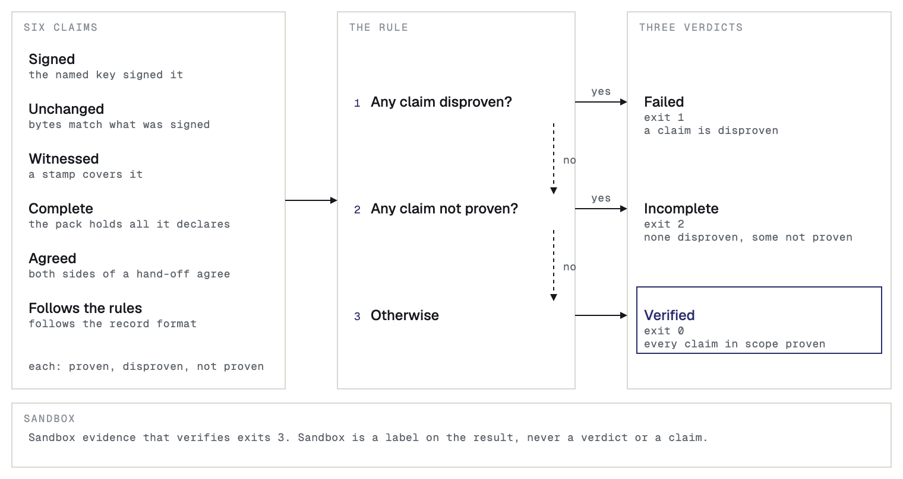
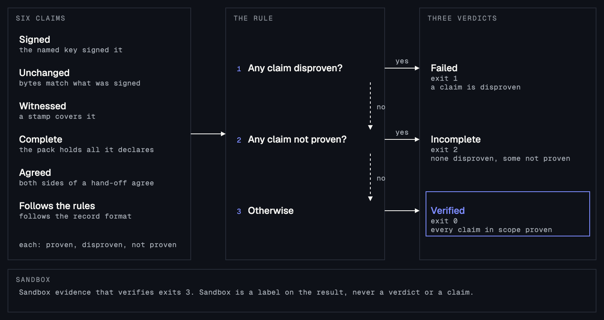

An evidence pack is the file that you give to a reviewer: an auditor, a regulator, an
insurer or a counterparty. This page builds one, checks it, and explains the result.
A reviewer checks it in the same way, so if someone gave you an evidence pack, start at
[Verify an evidence pack](#verify-an-evidence-pack).

## What an evidence pack holds

One zip file:

- `bundle.json`: the signed records, and for each one the proof that a stamp on the
  public record covers it.
- `logs/`: the content that you choose to disclose, one file for each record.

The reviewer needs nothing else: no account, no network call to Sanning.

## Wait for the stamp

Sanning stamps your records on an interval, not one record at a time. On a Live API
key, the stamp takes a few minutes. In the Sandbox, the stamp is simulated and takes
about a minute.

Until the interval that holds your records is sealed, there is no proof to put in an
evidence pack, and the build command tells you so:

```
bundle: no stamped records for agent "claims-triage" in 2026-11-04 → 2026-11-04
```

That means not yet. It does not mean that you have no evidence. A second line says how
many records are anchored and still waiting for a stamp. Wait, and run the command
again.

<AccordionGroup>
<Accordion title="How the stamp works">

Sanning publishes a commitment to your records on a public record, so that a third party
can confirm the records existed at a time without asking you or us.

It publishes **one commitment per interval**, not one per event.

#### Received and witnessed are not the same moment

**Received** means Sanning holds the record: your agent anchored it, and it is in the
index. **Witnessed** means a stamp covering that record has reached the public record. A
record is received the moment you anchor it, and witnessed only once its interval closes
and is published. The console's **Records** page states which of the two applies to each
row; do not read "received" as "witnessed" for a record whose interval has not closed yet.

A stamp is a transaction on the public record, and your pack carries its
transaction id, so your counterparty can fetch it from any gateway to that
record without asking Sanning. The witness kind in the pack names it, and [Verify an evidence pack](/guides/evidence#verify-an-evidence-pack) shows how to re-fetch it.

#### How it works

Every record anchored inside an interval becomes a leaf in a Merkle tree. When the
interval closes, Sanning signs the tree's root together with the interval bounds, and
publishes that. Your pack carries the signed stamp and an inclusion proof from your
record's leaf to that root.

Your counterparty checks the proof offline. Confirming the published transaction is a
separate, online step they can take whenever they like.

#### Why an interval

**Cost.** Ten thousand events in an interval cost the same to witness as one. Per-event
publishing would make continuous evidence too expensive to run.

**Privacy.** The published commitment is a root and an interval, not a list of what you
did. An observer sees that an organization anchored something, not what.

**Proof size.** An inclusion proof is a handful of hashes. Your counterparty verifies one
record without holding anyone else's.

#### What it means for you

<Warning>
  A pack cannot be built until the interval containing its records is sealed and
  published. Anchoring and handing over are minutes apart, not seconds.
</Warning>

If you build a pack too early, the command tells you:

```
bundle: no stamped records for agent "claims-triage" in 2026-09-01 → 2026-09-30
```

That means **not yet**. It does not mean the records are missing. Wait for the interval to
close and run it again.

##### How long you wait, and what sets it

Three things add up, and only the first depends on when you anchored:

| | |
|---|---|
| Wait for your record's interval to close | Between nothing and one full interval |
| A short lag before that interval is sealed | So a record written near the boundary is not left out |
| The sweep that notices it | Seconds |

**Read the interval off the stamp rather than off this page.** Every stamp
carries `interval_start` and `interval_end`, so the width that applied to your
records is inside the artifact you were handed. It is measured in minutes, and
Sanning tunes it: a shorter interval hands evidence over sooner and costs more
to witness, and this page would go stale the day it changed.

A useful planning rule while you build: **anchoring and handing over are
minutes apart, not seconds**, and a `bundle` run immediately after a run races
your own newest records.

The interval is also the time resolution of what you can prove. A stamp says
these records existed by the time this interval closed, not the second each one
was anchored. **Ordering is not affected by any of this**: each record commits
to the one before it, so a deletion leaves a hole and a reorder breaks the
chain, whatever the interval width.

#### In the Sandbox

The Sandbox stamps records with a simulated witness. A stamp seals within about a minute,
and it is never published to the public record. The pack is built the same way and
verifies offline, and the verifier reports it as Sandbox, with exit code 3, not as
production evidence. See [Sandbox and Live](/reference/api-keys#sandbox-and-live).

#### What is published, and what is not

| Published | Not published |
|---|---|
| A Merkle root over the interval | Any record |
| The interval's start and end | Any content, or any hash of your data |
| A keyed reference to the organization | The organization's name |
| Sanning's signature | Your signature, or your key |

The organization reference is keyed rather than a plain hash of the name, deliberately.
Organization names are low-entropy, and a plain digest would let anyone confirm a guess.

</Accordion>
</AccordionGroup>

## Build an evidence pack

Build an evidence pack where the agent's log store and signing seed are. The command
reads your records from Sanning with your API key, reads the content from your log
store, and verifies the result before it writes anything. If the evidence pack would
not verify, nothing is written.

### For a period

One agent, from one date to another. A date names a whole day.

<CodeGroup>

```bash TypeScript
npx @sanning/anchor bundle \
  --agent claims-triage \
  --from 2026-11-04 \
  --to 2026-11-04 \
  --logs ./logstore \
  --out claims-triage-2026-11-04.zip
```

```bash Python
sanning-anchor bundle \
  --agent claims-triage \
  --from 2026-11-04 \
  --to 2026-11-04 \
  --logs ./logstore \
  --out claims-triage-2026-11-04.zip
```

</CodeGroup>

Replace the following:

- `claims-triage` with your agent's name.
- The dates with the days that you want.
- `./logstore` with the root of your log store.

The command reads `SANNING_API_KEY` and `SANNING_SIGNING_SEED` from the environment.
With the seed, it signs the evidence pack and a declaration of what the pack holds.

### For a case

A case evidence pack holds every record of one case id, however long the case runs. It
takes no dates.

<CodeGroup>

```bash TypeScript
npx @sanning/anchor bundle \
  --agent assessor \
  --case case-5d1e9a \
  --logs ./logstore \
  --out assessor-case-5d1e9a.zip
```

```bash Python
sanning-anchor bundle \
  --agent assessor \
  --case case-5d1e9a \
  --logs ./logstore \
  --out assessor-case-5d1e9a.zip
```

</CodeGroup>

When agents in another organization took part, each organization builds its own
evidence pack with its own API key and log store. The reviewer reads them together as
one case. To keep your other records private from the other organization,
`--handoffs-only` puts only the case's hand-off records in the evidence pack.

To build evidence packs for two of your own agents in one command, give `--agent` more
than once, and put each agent's seed in `SANNING_SIGNING_SEEDS`, such as
`assessor=SEED_A,reviewer=SEED_B`. See [CLI](/reference/cli#bundle).

### From the console

On the **Records** page of the console, select **Build evidence**. It gives you the
`bundle` command to copy and run where your log store is. The console cannot build the
evidence pack for you, because Sanning never holds your content.

## What it discloses

The `bundle` command puts in the content of every record that it finds in your log
store. With `SANNING_SIGNING_SEED` set, it also signs a declaration of what the evidence
pack holds, and a record whose content is withheld on purpose, such as a hand-off
record that commits only to a message's hash, still reads Verified. Without the seed,
there is no declaration, and a record that discloses nothing reads Incomplete.

To keep your step records out of an evidence pack for another organization, build it
for the case with `--handoffs-only`.

## Keep the content

The log store holds the bytes that your records commit to. Without them, a reviewer
can check the signatures and the stamps, but not the content. For production, keep the
store in object storage that you control.

<CodeGroup>

```bash TypeScript
npm install @sanning/anchor @aws-sdk/client-s3
```

```bash Python
pip install "sanning-anchor[s3]"
```

</CodeGroup>

<CodeGroup>

```ts TypeScript
import { ObjectLogStore } from "@sanning/anchor";
import { S3ObjectStore } from "@sanning/anchor/s3";
import { S3Client } from "@aws-sdk/client-s3";

const logStore = new ObjectLogStore(
  new S3ObjectStore({ bucket: "evidence-claims", client: new S3Client({}) }),
);
```

```python Python
from sanning_anchor import ObjectLogStore
from sanning_anchor.s3 import S3ObjectStore

log_store = ObjectLogStore(S3ObjectStore(bucket="evidence-claims"))
```

</CodeGroup>

It is your bucket, and Sanning never sees it. On first use, the store checks the bucket
once and reports what it could not establish. A bucket that the store creates gets
Object Lock in GOVERNANCE mode for 365 days by default.

To build an evidence pack from the bucket, give `--logs` an `s3://` URL, such as
`s3://evidence-claims`, and set `SANNING_S3_ENDPOINT`, `SANNING_S3_ACCESS_KEY_ID` and
`SANNING_S3_SECRET_ACCESS_KEY` in the environment.

<Warning>
  The location of the content is signed into each record, and stamps are permanent.
  Bucket names and object keys often carry names of tenants, agents or models. Treat
  anything that can reach a location as public.
</Warning>

## Verify an evidence pack

You check an evidence pack in the same way that a reviewer does. Neither way needs an
account.

**In your browser.** Open [verify.sanning.io](https://verify.sanning.io) and drop the
file on the page. The open-source verifier runs in your browser, and the evidence pack
stays on your device.

**At the command line.**

<CodeGroup>

```bash Python
unzip claims-triage-2026-11-04.zip -d pack
pip install sanning-proof
sanning-proof verify pack/bundle.json --logs pack/logs/
```

```bash TypeScript
unzip claims-triage-2026-11-04.zip -d pack
npx @sanning/proof verify pack/bundle.json --logs pack/logs/
```

</CodeGroup>

Both commands give the same result, with the same exit codes. To read the evidence
packs of a case together, use the `case` command. See
[CLI](/reference/cli#case).

## Read the result

The first line is the result. It is one of three:

| Result | Means |
|---|---|
| **Verified** | Every check that applies passed |
| **Failed: do not rely on this evidence.** | A check found that something changed. Or, if it says "a record does not follow the rules", a record breaks the spec |
| **Incomplete: not everything could be checked.** | Nothing failed, and at least one check could not run |

After the first line come one line for each problem and, when there is something to do,
one line that starts `Next:` and says what. Then come these lines:

- `Note:` for something to know that does not change the result.
- `Sandbox:` when the records were made with a Sandbox API key.
- `Witness:` always, to say whether the stamp was checked on the public record.

The exit codes are 0 Verified, 1 Failed, 2 Incomplete, 3 Verified with Sandbox records,
and 4 when the check could not run. For the `--json` output, see
[CLI](/reference/cli#json-output).

## What Verified proves

The verifier checks six claims. Each claim is proven, disproven or not proven, or not
in scope when nothing in the evidence pack is about it:

| Claim | The verifier asks |
|---|---|
| Signed | Did the key that the evidence pack or record names sign it? |
| Unchanged | Do the bytes agree with what was signed? |
| Witnessed | Does a stamp cover each record? |
| Complete | Does the evidence pack hold everything that its signed declaration and its stamp say it holds? |
| Agreed | Do the two sides of each hand-off agree? |
| Follows the rules | Does each record follow the spec that it names? |

One rule makes the result: any claim disproven gives Failed. Otherwise, any claim not
proven gives Incomplete. Otherwise, the result is Verified.




## What Verified does not prove

A Verified result does not prove the following:

- That the agent was right.
- That the agent recorded every step, or that you gave the reviewer every run.
- That the agent follows a rule or a law.

Those conclusions belong to the people who review the evidence.

<AccordionGroup>
<Accordion title="What a hand-off record does not prove">

A verified hand-off is a narrow statement: the message the second agent
recorded is the message the first agent recorded, and each side was signed by
the key it names. This page states what that statement does not reach. Say it
to whoever relies on your evidence, before they read more into it.

#### Integrity, not accuracy

A record proves what was recorded, not that it was true.

If an assessing agent recommends approval and a reviewing agent receives that
recommendation, a verified pair shows the reviewer recorded exactly the
bytes the assessor sent. It does not show the reviewer acted on them, or
accepted them.

Pairing grades whether the two sides commit to the same message, and never
what the receiver did with it. `outcome` on an `agent.handoff.received` record says
what the receiving agent claims it did (`accepted`, `rejected` or `failed`),
and pairing does not read that field: a received record carrying
`outcome: "rejected"` pairs exactly as `verified` / `verified` as one carrying
`"accepted"`. A verified pair over a rejected received record still says only
that the reviewer's
record matches the assessor's; it says nothing about whether the reviewer
acted on the recommendation, whether the recommendation was right, whether the
data behind it was correct, or whether the model was fit for the task. Those
are conclusions for the people reviewing the work. Sanning is content-blind: it
holds commitments, never the content, so it cannot vouch for the content
either.

#### Attribution, not independence between organizations

A pair across two organizations proves that two keys each signed their own
side. It does not prove that two independent parties hold those keys.

Pairing matches on keys and hashes and never on which account a record came
from, so a pair verifies across packs from two organizations. The verifier flags
one key signing both sides of a hand-off. It cannot tell two keys held by one
party from two keys held by two, because binding a key to an organization
happens outside the evidence. An agent's identity informs a reader and never
decides whether evidence verifies. If independence matters to your review,
establish who holds each key by other means.

#### A record, not a control

Sanning records what agents did, and lets anyone check the record later. It
does not approve, block or enforce what an agent may do, and a verified record
of a decision is not evidence that the decision was permitted.

`receive` refuses when a record does not verify, or when the message that
arrived is not the one the sender committed to: see
[Hand work to another organization](/guides/langchain#hand-work-to-another-organization)
for the full list. Every one of those is an integrity check, not a policy one.
Whether an agent is allowed to send a message, or to act on one, is decided by
your own systems, never by `receive`.

#### More than one message in one direction

Pairing looks for a signed counterpart by key and by record type. It does not
look at case, at sequence, or at which message a sent or received record names
to narrow that search. When the other side holds more than one record that
could be a counterpart (two messages in the same direction, fan-in, fan-out, or
the same pair of records appearing again in another case), the reader grades
every one of those candidates and reports the worst, unless a candidate is
already accounted for.

A candidate that another record already accounts for, as a mutually named
pair with the same message and the same sequence, is set aside before the
reader grades. An honest exchange of several messages in one direction then
reads `verified`, rather than `failed` on `message_hash` and `sequence` with
the finding `counterpart_ambiguous`, which is what an unaccounted-for
candidate still reads as. You can tell that apart from a genuine tamper by
reading the candidates themselves: one of them reads `verified`, and the rest
are the exchange's other honest messages, not a decoy planted beside a broken
pair.

A formed pair also has to name each other: the sent record names the received
record's signer, and the received record names the sender's. An honest record
can fail that check, `counterparty_named`, when its counterparty signed a
second record of the same message at the same sequence, for example one
message sent to two recipients.

#### Step records declared under the wrong role

A pack's declaration marks every record it holds with a `role`, `handoff` or
`step` (`sanning.declaration/v2`). A record declared `handoff` must be claimed
in the declaration's hand-off sides; a record declared `step`, such as a
closing record or an ordinary log line, must not be, and sits outside the
hand-off scope test entirely. A record signed under the wrong role, or claimed
under the wrong role, is named rather than read past, so a case holding one
does not read `verified`. Within its own role, a step record's content can
still be withheld on purpose without moving the verdict.

A `sanning.declaration/v1` pack carries no `role` field. Its declared records
that no pair claims are named the same way, and a pack with no declaration at
all is named as one that does not say what it holds. The check cannot take
the audited party's own word for which of its records are hand-off sides, so
an unclaimed one is always named rather than assumed innocent.

#### The wait for independent time

A record is witnessed only once its interval is stamped.

Until then, the only time on a record is the time the agent signed into it,
which is the agent's own claim. When a receiver checks a hand-off on arrival,
it checks the sender's signature and the message, offline, in the moment; it
does not check when the record was made. Independent time arrives when the
interval holding the record closes and its stamp is published on the public
record, minutes later rather than seconds. [Wait for the stamp](/guides/evidence#wait-for-the-stamp)
explains the interval and how long the wait is. A Sandbox stamp is simulated and gives no
independent time, so a Sandbox pack never supplies it.

#### What a receiver cannot check on arrival

Three questions stay open at the moment a message arrives, and each has a
different answer later:

- **Whether the sender's key is enrolled and not revoked.** That is a question
  about your organization's agents, and `receive` deliberately does not ask it. Weigh it on your own
  terms after the record verifies.
- **When the record was made.** Independent time comes with the stamp, as the
  previous section describes.
- **Whether anything was left out.** A pack's signed declaration says what its
  holder claims the pack holds, and a reader checks the pack against that claim.
  Nothing proves a party showed you every exchange there was.

</Accordion>
</AccordionGroup>

## Sandbox evidence

An evidence pack of Sandbox records that passes every check reads Verified, adds the
line "Sandbox: these records are sandbox records, not production evidence.", and exits
3, not 0. One that fails or is incomplete exits 1 or 2, as a Live one does. The Sandbox stamp is simulated, so no public record holds it. Use a
Sandbox evidence pack to test. Do not rely on it as evidence. No flag turns exit
code 3 into 0.

## Evidence from more than one organization

When a case crosses organizations, the reviewer gets one evidence pack from each side
and reads them together. The result of a case is the result of its worst evidence
pack: Failed, then Incomplete, then Verified. The claim "Agreed" shows that both sides
of each hand-off match.

A missing side is a finding, never a failure. If no evidence pack from the other
organization is there, the verifier cannot say what that side recorded, and it says so.

## Give it to the reviewer

Send the file. The reviewer verifies it in the same way, in a browser or at the command
line, and needs no account. When the bundle command writes an evidence pack, it tells
Sanning that it did: the agent, the window, the record count and a hash of
`bundle.json`. It never sends the evidence pack itself. You find the report later
under **Evidence** in the console.
