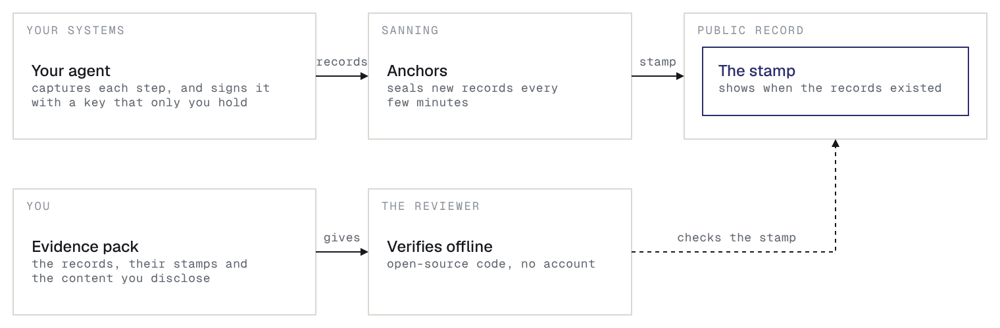
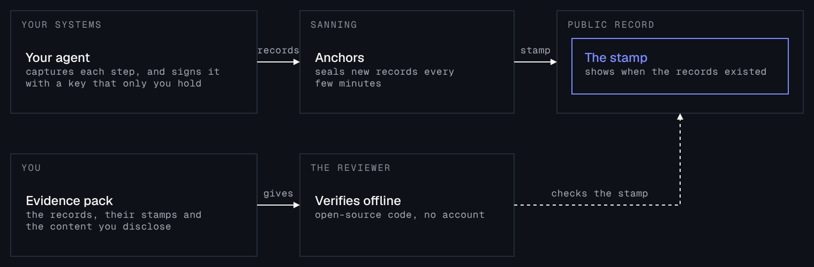

Sanning records what your AI agents do, so that someone else can check it without
trusting you or Sanning.

## Why it matters

When an agent acts for your business, someone asks later what it did: an auditor, a
regulator, an insurer or a counterparty. A log is your own word. Evidence from Sanning
is something they can check for themselves.

## How it works

1. **Capture.** An adapter hooks into your agent's framework, so each step of a run
   becomes a record.
2. **Sign.** Your agent signs each record in your process, with a key that only you
   hold. The content stays with you.
3. **Anchor.** Every few minutes, Sanning seals your new records on a public record, so
   any change to a record is evident.
4. **Verify.** You give a reviewer an evidence pack. They check it offline, with
   open-source code. They need no account.

## What your agent records

Your agent records its work in an open spec,
[`sanning.agent/1`](https://github.com/sanning-io/specs/blob/main/specs/agent-events.md). The
spec gives each kind of step a fixed shape, so the records answer the questions that a
reviewer asks:

| A reviewer asks | Your agent records |
|---|---|
| What did the agent do, and in what order? | Each model call, tool call and retrieval, from its start to its end |
| What did it decide? | A decision, from a tool that you name as a decision |
| Who approved it? | The request for approval, and the answer |
| What went to another organization? | The hand-off, signed by each side |
| How did it end? | The outcome of each step, any errors, and the end of the run |

Each record is signed as it happens and stamped within minutes. So the answers are
evidence, not a story that you rebuild from logs when someone asks. The spec is open,
so any verifier can check that each record follows it. For every type and field, see
[Record types](/reference/record-types).

## Who you trust

Nobody in the middle. Sanning is never in the trust path: a reviewer checks the
signatures and the public record, not Sanning. Sanning receives the signed envelope,
the record type and the ids. It never receives your signing key or your content. If
Sanning goes offline, evidence that you already gave out still verifies.

## What a reviewer gets

An evidence pack: the records, their stamps, and the content that you choose to
disclose. They check it and get one result: Verified, Failed or Incomplete.

A Verified result proves who signed each record, that nobody changed it, and that a
stamp covers it. It does not prove that the agent was right. The people who review the
evidence decide that.

## Start

<CardGroup cols={2}>
  <Card title="Quickstart" icon="rocket" href="/quickstart">
    Get an API key and install the SDK.
  </Card>
  <Card title="LangChain and LangGraph" icon="link" href="/guides/langchain">
    Record every run of your agent.
  </Card>
  <Card title="Build and verify evidence" icon="file-check" href="/guides/evidence">
    Make an evidence pack and check it.
  </Card>
  <Card title="Someone gave you evidence?" icon="circle-check" href="/guides/evidence#verify-an-evidence-pack">
    Verify it. You need no account.
  </Card>
</CardGroup>
