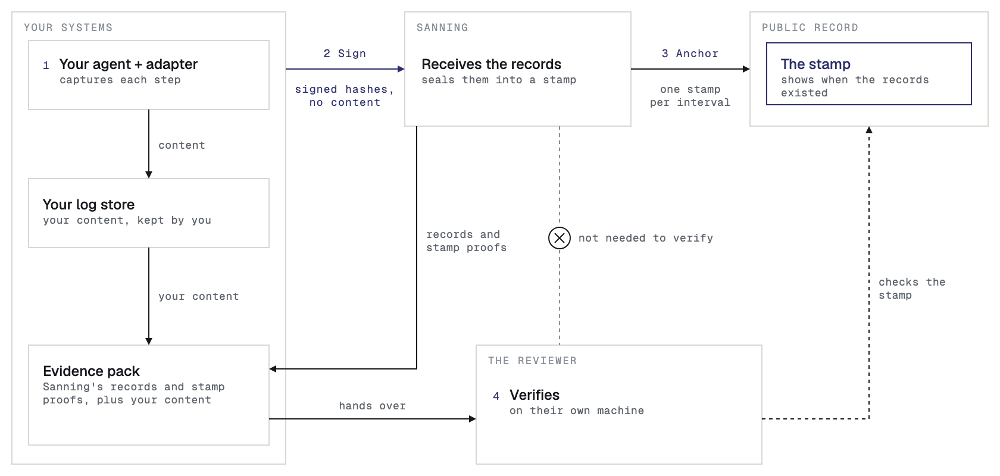
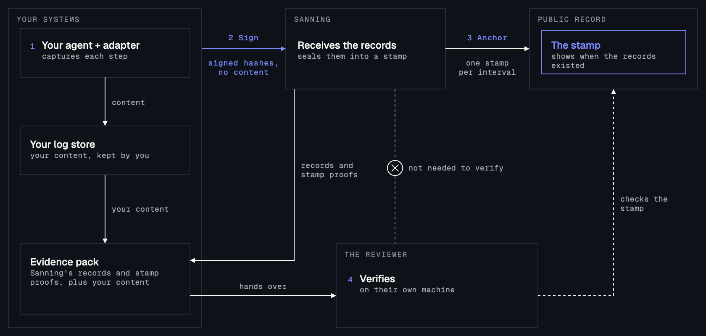

Each step of your agent becomes a signed record. Sanning seals your records into a stamp and publishes the stamp to the public record, a permanent record that Sanning does not control. Later, you build an evidence pack for a case and hand it to a reviewer, who verifies it on their own machine.

## Why it matters

Your agents act for you. Later, someone asks you to prove what they did: an auditor, a regulator, an insurer or a counterparty. A log that you control does not prove it to them, because you could have changed it. Sanning gives them something they can check for themselves.

## How it works

1. Capture. An [adapter](/adapters) watches your agent's framework and turns each step into a record. The content of each step goes to your own log store, which is storage that you control.
2. Sign. Your agent signs each record with its signing key. Sanning receives the signed record. The record holds hashes of your content, never the content.
3. Anchor. Every 10 minutes, at the end of an interval, Sanning seals the records of that interval into one stamp and publishes the stamp to the public record.
4. Verify. You build an evidence pack for a case and give it to a reviewer. The reviewer checks it on their own machine and needs no account. See [Verify an evidence pack](/evidence/verify).

## Core ideas

| Idea | What it is |
|---|---|
| Record | One step of your agent, signed with the agent's signing key. A record holds hashes of your content, never the content. |
| Signing key | A key that you make from a seed that only you keep. Each agent's signing key signs its records and is the agent's identity. Your organization's hand-over key seals the packs that you hand over. See [Build an evidence pack](/evidence/build#how-to-build-an-evidence-pack). |
| Run | One execution of an agent, from its first record to its closing record. The adapter, the code that records your agent's steps, opens the run, and it closes the run when you call `close()`. |
| Case | The matter the work is for, such as a claim or a loan. Your agents put its ID on every record, across runs and agents. |
| Stamp | One seal over the records of an interval, a period of 10 minutes. Sanning publishes each stamp to the public record. |
| Evidence pack (a pack, for short) | The zip you build and hand over: Sanning's records and stamp proofs, with your own content beside them. You can build one for a case. |
| Verdict | The answer of the [verifier](/evidence/verify#what-the-verifier-checks), the program that checks an evidence pack: Verified, Failed or Incomplete. |

Each record carries its case ID permanently, and nobody can change or withdraw it. Use an ID that means nothing outside your systems, and keep names and other personal data out of it. These pages write it as `CASE_ID`.

## SDKs and adapters

Sanning's SDKs, for TypeScript and JavaScript and for Python, are the packages that sign each record and send it to Sanning. An [adapter](/adapters) connects the SDK to your agent framework, so you write no records by hand. The [Quickstart](/quickstart) has the install commands.

MCP and OpenTelemetry (OTEL) ingest APIs are on the roadmap.

## How trust works

Your content stays in your log store, and Sanning receives only the signed records.

The public record is an independent witness: it confirms when each record existed, and Sanning does not control it. If anyone changes a record later, including you or Sanning, the check fails.

You build the evidence pack from two halves: Sanning's records and stamp proofs, and your own content. A reviewer needs the pack and nothing from Sanning, and the verifier checks it on their own machine.

To also confirm each stamp on the public record, the reviewer gives the verifier the address of a public gateway, a web server that serves the public record. Without that lookup, the report says `Witness: Not checked`. The command line check uses no Sanning server. The verify page looks up the stamps through a Sanning server. To check them yourself, use [the command line](/evidence/verify#check-it-at-the-command-line) with a gateway that you choose.

A Verified verdict says that the records are the ones your agent signed, that none has changed since, and that stamps cover them. It does not say that the agent decided well, or that what it recorded is true. The people who review the case decide that. For what the verifier checks, see [Verify an evidence pack](/evidence/verify).

## Built on standards

| Standard | What it does |
|---|---|
| [SHA-256](https://csrc.nist.gov/pubs/fips/180-4/upd1/final) | Hashes your content in your own process. |
| [Ed25519 signatures](https://www.rfc-editor.org/rfc/rfc8032) | Signs each record with your agent's signing key. |
| [JSON canonicalization, RFC 8785](https://www.rfc-editor.org/rfc/rfc8785) | Gives every record one exact byte form, so a signature checks the same way everywhere. |
| [Merkle trees, RFC 9162](https://www.rfc-editor.org/rfc/rfc9162) | Seals many records into one stamp, and proves that a record is in it. |
| [Sanning's record format](https://github.com/sanning-io/specs) | Every adapter writes this format and the verifier checks it, so records from agents on different frameworks read the same way. |

## Next

<CardGroup cols={2}>
  <Card title="Quickstart" icon="rocket" href="/quickstart">
    Make an API key and a seed for your signing key, and install the SDK.
  </Card>
  <Card title="Verify an evidence pack" icon="circle-check" href="/evidence/verify">
    For reviewers: verify a pack on your own machine, with no account.
  </Card>
</CardGroup>
